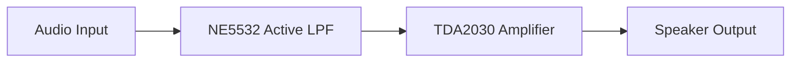

<h1 align="center">NE5532 Active Low Pass Filter</h1>

  
  <b>A Personal Audio Project, Engineered for the Sound I Want.</b>

  

## Overview

This project is a custom-built **NE5532 Active Low-Pass Filter**, designed to meet my personal audio requirements. The circuit is implemented on a single PCB with a 12V DC power input. For the current version, a prebuilt TDA2030 mono amplifier module is used to provide speaker output and test the overall system.&#x20;

## Features

- NE5532-based Active Low-Pass Filter
- Custom-designed PCB implementation
- 12V DC power input
- Designed around specific audio requirements
- Suitable for DIY subwoofer applications
- Complete schematic and PCB design files
- Future-ready design for amplifier upgrades

## Audio Signal Flow

---

## License

This project is open-sourced under the [MIT License](LICENSE).

---

  <i>Built around the one thing that inspires it all — MUSIC❤️</i> 

  Made with ❤️ by <b>NP-Vishwakarma</b>
   
  Feel free to fork, modify, and build your own version.
   
  Built something with it? I'd love to see it — tag me!🎶

